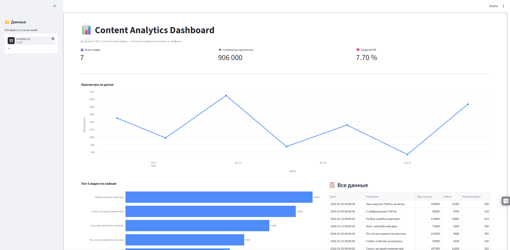

# 📊 Content Analytics Dashboard

Веб-дашборд на **Streamlit** для аналитики контента (TikTok/YouTube). Загружаете CSV
со статистикой видео — получаете KPI, график просмотров и Топ-5 по лайкам.
**[Посмотреть живое демо в браузере](https://content-analyzer-bottk.streamlit.app/)**



## Возможности

- Загрузка CSV с **автоопределением разделителя** (`,` или `;`).
- **Гибкий парсинг дат**: понимает `дд.мм.гггг` и ISO (`гггг-мм-дд`).
- KPI: количество видео, суммарные просмотры, средний ER.
- Линейный график просмотров по датам (Plotly).
- Горизонтальная гистограмма Топ-5 видео по лайкам.
- Таблица со всеми данными.

**ER** считается как `(Лайки + Комментарии) / Просмотры × 100`.

## Структура проекта

```
content-analyzer/
├── app.py                 # UI, layout, оркестрация
├── requirements.txt       # Зависимости
├── .streamlit/config.toml # Настройки темы/layout
├── src/
│   ├── data_loader.py     # Загрузка и валидация CSV
│   ├── metrics.py         # KPI и агрегации
│   └── charts.py          # Функции построения Plotly-графиков
├── assets/screenshot.png  # Скриншот интерфейса
└── data/sample.csv        # Пример данных
```

## Установка

```bash
python -m venv .venv
# Windows:
.venv\Scripts\activate
# macOS/Linux:
source .venv/bin/activate

pip install -r requirements.txt
```

## Запуск

```bash
streamlit run app.py
```

Откройте браузер по адресу `http://localhost:8501` и загрузите CSV в боковой панели.
Для быстрой проверки используйте `data/sample.csv`.

## Формат CSV

Обязательные колонки: `Дата`, `Название`, `Просмотры`, `Лайки`, `Комментарии`.
